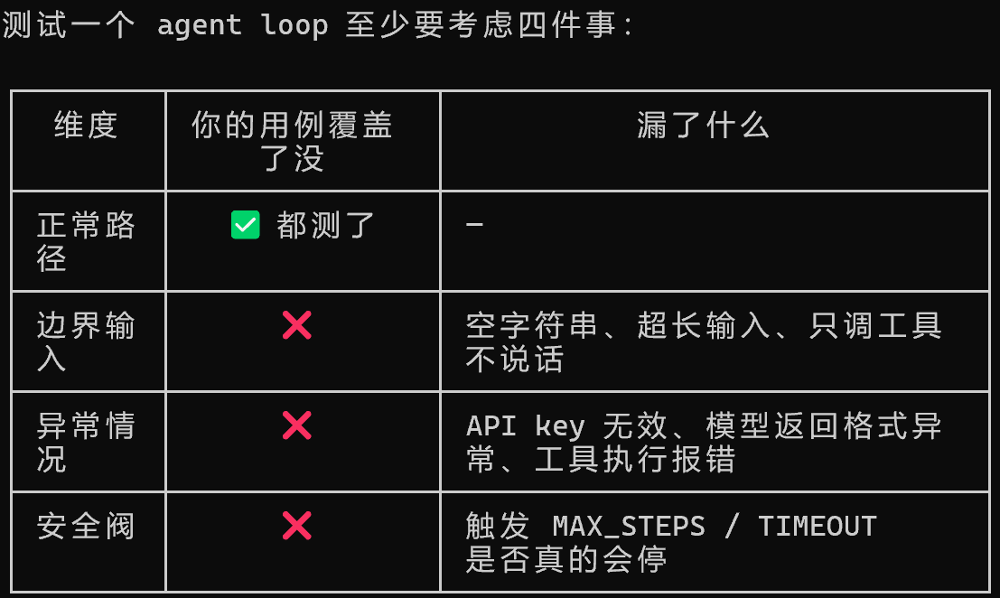

Agent 学习笔记

## L0

### 1. Agent vs Workflow

- **Agent**：没有那么多细节的要求，更多的是像人一样思考。
- **Workflow**：is constructed to be a flow —— 规定好的一个流程，有输入输出、特定不可更改，不需要去思考有没有更好的方法。

### 2. Agent Circle

**Observe → Think → Act → 循环**

- **Observe** 负责：接收外部指令
- **Think** 负责：思考，它要变成什么样才符合要求（更快速、更优化……），基于当前信息做决策
- **Act** 负责：实施，真正去执行这个思考

循环终止条件：

- 任务完成，用户满意
- Agent 判断没有可改进的空间
- 达到预设最大步数
- 遇到无法恢复的错误

### 3. 什么时候不用 Agent

| 场景 | 原因 |
| --- | --- |
| 图文分离的简单多模态任务 | agent 会搞得很复杂，增加不确定性 |
| 固定格式表格 / 数据处理 | 输入输出完全确定，脚本即可，agent 可能偏离预期格式 |
| 机密内容 | 可能导致泄露 |
| 实时性要求极高的操作 | Agent 循环多次往返有延迟，不适合高频交易、实时控制等场景 |

### 4. Agent Loop

```
while True:
    1. 问模型"现在做什么？"
    2. 模型说"调工具 X，参数是 Y"——你去执行
    3. 把执行结果喂给模型，回到第 1 步
    直到模型说"做完了，答案是 Z"——退出
```

## L1

### 5. Step vs Tool Call Count

- step 是调用 LLM 的次数
- tool call count 是调用工具的次数
- 工具是自带的，调用 API 的次数才是统计成本的方式

### 6. Append Assistant

```
消息1: user      → "查北京天气"
消息2: assistant → "我要调 get_weather，tool_call_id=abc" ← msg
消息3: tool      → "北京：5°C"（tool_call_id=abc）← 必须跟在 msg 后面
```

API 看到消息3时，会往前找：哪个 assistant 消息声明过 `tool_call_id=abc`？找到消息2，匹配成功。

换句话说，`tool_calls` 不是外部系统发来的，它就是模型的"回答"——一种特殊的回答。所以整个对话链条永远是：

user 问 → assistant 答/调工具 → tool 返回结果 → assistant 再答

assistant 永远是说话的那一方，tool 只是替它跑腿。

多工具并行调用示例：

```text
assistant:
  tool_calls = [
    { id: "call_1", name: "get_weather", arguments: {"city": "北京"} },
    { id: "call_2", name: "get_weather", arguments: {"city": "深圳"} }
  ]

tool:
  { tool_call_id: "call_1", content: "北京：5°C" }

tool:
  { tool_call_id: "call_2", content: "深圳：28°C" }
```

关键点：`tool` 结果不是只带工具名，而是通过 `tool_call_id` 精确对应某一次工具请求；多个工具并行调用时，配对错就会把结果挂到错误的问题上。

### 7. 测试用例

单工具 / 多工具 / 无工具



### 8. 相同点 vs 不同点（对比 Claude Code）

**相同点：**

1. 都是同样的循环模式：用户输入 → 模型决策 → 调工具 → 结果喂回 → 再问模型 → 直到模型说停
2. 工具都通过 schema（name / description / parameters）提前告知模型，模型通过 function calling 选择调哪个

**不同点：**

1. **工具数量**：你的 agent 只有 2 个固定工具，Claude Code 有几十个（文件读写、搜索、shell、web fetch 等），工具系统可以动态扩展
2. **权限控制**：你的 agent 任何工具都直接执行（eval 说跑就跑），Claude Code 分三层——有的静默执行、有的弹确认框、有的直接拒绝

### 9. README 文件到底是干啥的

就两个作用：

1. 别人打开你的项目能跑起来——装什么依赖、配什么环境变量、运行哪个命令、预期看到什么输出
2. 你自己一个月后回来看还能跑起来——不然你早忘了 DeepSeek API key 怎么配的了

比如你这个 L1 给别人，没有 README 的话，他打开 `main.py` 看到 `from openai import OpenAI` 就迷糊了——用的不是 OpenAI 是 DeepSeek 啊？key 从哪来？装了哪些包？

README 就是项目的"说明书"，不写你就是项目唯一的用户，写了对别人（和将来的你）才有可用性。

## L2

### 1、三层记忆
┌──────────────────────────────────────────────────────┐
│  Layer 1: messages（对话上下文）                       │
│  生命周期：单次会话，进程内存                           │
│  存储内容：完整的 API 消息历史（user/assistant/tool）    │
│  问题：太长会超 token 限制，需要裁剪                     │
├──────────────────────────────────────────────────────┤
│  Layer 2: session_store（会话记忆）                    │
│  生命周期：单次会话，进程内存                           │
│  存储内容：提取出来的关键信息（用户偏好、重要事实）        │
│  位置：注入到 system prompt 中，不占 messages 位置       │
├──────────────────────────────────────────────────────┤
│  Layer 3: long_term（长期记忆）                        │
│  生命周期：跨会话，存磁盘（JSON 文件）                   │
│  存储内容：用户认为重要、需要跨会话记住的东西              │
│  实现：JSON 文件读写 + 关键词检索                       │
└──────────────────────────────────────────────────────┘
```
1. Agent Loop（main.py）
核心概念：LLM 是无状态的，每次调用独立。Agent loop 的本质是「用 messages 列表自己维护状态」：


循环 { 调模型 → 有 tool_calls? → 执行工具→结果塞回 → 继续 }
     { 没有 tool_calls → 模型直接回答了 → 返回 }
面试必会：

为什么要有 MAX_STEPS / 超时？ → 两者防的是不同失控：
- **最大步数**：限制 Agent Loop 能循环/调用 LLM 多少轮，防止模型反复调工具绕圈，同时控制 Token 成本和延迟。
- **超时**：限制真实耗时。某一次模型请求或工具调用可能卡住，此时步数还没增加，只有超时能终止等待。
- 工程上通常同时加三层护栏：单次操作超时 + 整个任务超时 + 最大步数。
- 一句话：最大步数限制“循环太多次”，超时限制“某一步或整体太慢”。

for 循环 vs while True？ → for 有天然上限，while 要自己管退出条件。答「用 for + 步数上限」体现你的谨慎。
上下文窗口管理 → token 是钱的单位。裁剪策略：system 全保留（定义行为），非 system 只留最近 N 轮，被裁的用摘要替换。
刚踩的那个 bug 本身也是考点：OpenAI SDK 返回的是 Pydantic 对象（ChatCompletionMessage），不是 dict——用 .content 访问、不能 ["content"] 下标。面试问「你有没有遇到过 SDK 版本坑」，这就是现成答案。

2. 工具调用 Function Calling（tools.py）
核心概念：工具是 agent 的「手脚」。模型只能想不能做——不能查实时信息、不能精确计算、不能操作外部系统。工具补齐这个 gap。

面试必会：

Function Calling 原理：请求带 tools 参数（JSON Schema）→ 模型返回 tool_calls（含工具名+参数 JSON）→ 你执行真正的函数 → 以 role: "tool" 塞回。关键点：模型不执行工具，是「你」执行，模型只是说「我想调这个」。
工具注册表（registry）设计：为什么集中管理？→ 加第 10 个工具时只需加一条，schema/func/risk 都在一处。这是「单一职责 + 可扩展」的体现。
错误分类处理（这是 L2 最值钱的部分，能拉开差距）：
参数 JSON 解析失败 / 工具不存在（模型幻觉）/ 执行超时 / 空结果 —— 四类错误分开处理，不吞错误，让模型看到错误后自己换方式重试。
风险分级：safe / needs_approval / blocked → agent 安全，面试常问「agent 能不能自动执行危险操作」。
3. 三层记忆（memory.py）
核心概念：不同时间尺度需要不同的「记忆」，一层不够：

层	生命周期	存什么
messages	单会话、内存	原始对话记录
session	单会话、内存	提取后的摘要（偏好/事实）
long-term	跨会话、磁盘	需要长期记住的东西
面试必会：

「messages 和记忆的区别」 → messages 是原始记录（会超 token 被裁剪），记忆是提取后的结构化信息（注入 system prompt，不占 messages 位置）。这个区别是高频考点。
长期记忆怎么触发写入？ 三种方案：约定格式（L2 的 [[REMEMBER]] 标签）/ 用另一个 LLM 总结（贵）/ 用户手动。你要能讲出 trade-off。
长期记忆怎么检索？ 关键词匹配 → 向量检索 → 混合检索 + 时间衰减。能答到「混合检索」这一层，说明你知道真实产品（Claude Code 等）怎么做。

混合检索：
两种各跑一遍，结果合并。关键词管"精确命中"，向量管"语义相关"，取长补短。

常见的合并方式是 RRF（Reciprocal Rank Fusion，倒数排名融合）：不管分数绝对值，只看排名，两条检索结果的排名倒过来加起来：


RRF_score = 1/(k + 关键词排名) + 1/(k + 向量排名)   # k 是常数
4. RAG（rag.py）
核心概念：先检索相关资料，再喂给模型「参考着回答」。

面试必会：

RAG vs 微调（几乎是必考题）：
维度	RAG	微调
知识更新	改文档即生效	重训
可溯源	✅	❌（融入权重）
成本	低	GPU 高
幻觉	有原文对照	可能自信胡说
五步流水线：加载 → 分块 → 向量化 → 存储 → 检索。每步都有设计选择，能讲出「为什么」就是加分项。
分块（chunking）：为什么按句子切而不是固定字符？→ 语义完整性。chunk_size 太小语义碎、太大无关信息多（300-500 平衡）。overlap 的作用。
Embedding 本质：把文字变向量，语义近的向量距离近。
余弦相似度：cos = (A·B)/(|A|·|B|)，[-1,1]，越接近 1 越像。要会写公式、会手算点积。
检索的坑：top-K + 相似度阈值（0.1 是经验值）过滤噪声；纯向量检索对「精确匹配」不敏感，成熟系统用混合检索。

4.检索增强生成
（RAG，Retrieval-Augmented Generation） 
拆成三个词就懂了：

检索（Retrieval）：先去找资料
增强（Augmented）：把找到的资料"塞给"模型，增强它的输入
生成（Generation）：模型参考这些资料，生成回答