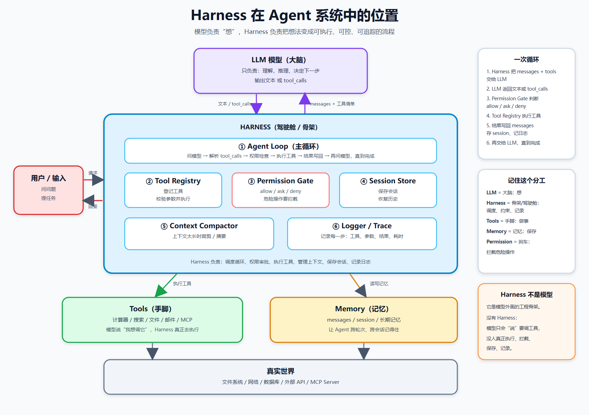

# L3 Harness 源码拆解 · 五问必答

> 对象：`projects/l3-nano-harness/main.py`（模块化 agent harness，约 1250 行）
> 对应路线图 [README.md L3「必答问题」](README.md)，是 L3 的正式产出物
> 日期：2026-09-04

---

## 前置：一句话看清这个 harness

把「裸奔的 agent loop」拆成 5 个各管一摊的模块，再由 `Agent` 类把它们组装起来：

```
Agent(Loop 编排) ─┬─ ToolRegistry    工具有没有、怎么调（注册/查找/执行）
                  ├─ PermissionGate  现在能不能调（safe/ask/deny）
                  ├─ SessionStore    历史存盘/恢复（sessions/*.json）
                  ├─ Logger          分级日志（INFO/WARN/ERROR）
                  └─ Context 压缩     超长时裁最老轮次（Agent 内方法）
```

核心哲学：**每个类只做一件事，Registry 和 Gate 零耦合，Agent 只编排不实现。**

---

## 0. Harness 在 Agent 系统中的位置（总览图）

> 图：`notes/media/harness-diagram.png`（可编辑源文件：`notes/media/harness-diagram.html`）



一句话：

> **LLM 是大脑，Harness 是骨架和驾驶舱；模型负责想，Harness 负责把想法安全地变成行动。**

### 0.1 分工表

| 部分 | 角色 | 负责什么 |
|---|---|---|
| LLM 模型 | 大脑 | 理解、推理、决定下一步；输出文本或 `tool_calls` |
| Harness | 骨架 / 驾驶舱 | 调度循环、执行工具、权限检查、管理上下文、保存会话、记日志 |
| Tools | 手脚 | 计算器、搜索、文件、邮件、MCP 等真正干活的工具 |
| Memory | 记忆 | `messages`、会话记忆、长期记忆 |
| Permission Gate | 刹车 | `allow / ask / deny`，拦截危险操作 |
| 外部环境 | 真实世界 | 文件系统、网络、数据库、外部 API、MCP Server |

### 0.2 一次循环

1. Harness 把 `messages + 工具清单` 交给 LLM
2. LLM 返回文本，或返回 `tool_calls`
3. Harness 解析 `tool_calls`
4. `PermissionGate` 判断：允许 / 询问 / 拒绝
5. `ToolRegistry` 真正执行工具
6. 结果写回 `messages`，保存 session，写日志
7. Harness 再交给 LLM
8. 重复，直到模型给出最终答案

### 0.3 对应本项目的代码

| 图中的模块 | 本项目的位置 |
|---|---|
| LLM 模型 | `main.py` 里的 DeepSeek `chat.completions.create` |
| Agent Loop | `Agent.run()` |
| Tool Registry | `ToolRegistry` |
| Permission Gate | `PermissionGate` |
| Session Store | `SessionStore` |
| Context Compactor | `Agent._manage_context()` |
| Logger / Trace | `Logger` |
| Tools | `TOOL_DEFINITIONS` 里的 `calculator / get_weather / web_search / send_email` |
| Memory | `messages` + `SessionStore` |

### 0.4 两个比喻

- **开车**：LLM = 司机的大脑；Harness = 车（方向盘、油门、刹车、仪表盘、安全带）；Tools = 手脚和工具箱；Memory = 行车记录仪和导航历史；Permission Gate = 刹车和门禁。
- **公司**：LLM = 提方案的人；Harness = 项目经理 + 流程 + 审批 + 档案；Tools = 一线执行；Memory = 公司档案；Permission Gate = 风控。

### 0.5 记住这一句

> **模型负责想，Harness 负责管、执行、拦、记。**

---

## 必答 1：agent loop 在哪个文件？核心逻辑多少行？

**答**：agent 的主循环写在本项目唯一的 `main.py` 里，具体在 `Agent.run()` 方法中（行号 1011–1095），循环体本身约 40 行（1046–1088）。

`run()` 是一个「一次完整对话」的入口：先装载会话（传 `session_id` 就恢复历史，不传就从干净的 system + user 开始），接着进入主循环。循环用 **`for step in range(self.MAX_STEPS)`**（1046），而不是 `while True`。原因是 agent 调工具的次数不可控——模型可能反复调同一个工具绕圈，必须给它一个「最多转几圈」的硬刹车；`for` 直接把上限写进循环条件，比 `while True` 加手动 `if break` 更不容易漏。这道刹车就是类常量 `MAX_STEPS = 10`（842），另外还有第二道 `TIMEOUT = 60` 秒超时（843），每轮循环开头先查时间（1047），超时就强制终止。

循环体每轮只做四件事：① 调 `_manage_context` 压缩上下文（1051）；② 调模型 `chat.completions.create`，同时把工具清单 `get_schemas()` 一起发过去（1055–1059）；③ 看模型返回——如果带 `tool_calls`（要调工具），就逐个 `_handle_tool_call` 执行、把结果塞回 messages，然后 `continue` 再问一轮（1069–1076）；④ 如果直接给了 `content`（答案），拼 footer、存会话、`return` 收工（1078–1088）。没走完就结束（超时/超步/模型报错）则返回停止原因（1090–1095）。

**易错点**：`run()` 是 Agent 的整条主循环（管「转几圈」），而 `execute()` 是 ToolRegistry 执行一次具体工具（242），二者是**包含关系**——run 大循环内部 → `_handle_tool_call` → `tool_registry.execute()`。

---

## 必答 2：工具是怎么注册的？tool schema 包含哪些字段？

**答**：注册的起点是一张数据表 `TOOL_DEFINITIONS`（725–812），里面每条记录有 4 个字段：`name`（工具名）、`func`（真正干活的函数）、`risk_level`（风险等级）、`schema`（给模型的说明书）。Agent 启动时调用 `_register_builtin_tools()`（865–877），用 `for` 循环逐条 `tool_registry.register(name, func, schema, risk_level)` 完成注册；注册过程中会校验 schema 结构、防重名、检查 `risk_level` 是否合法，通过后存进 `self.tools[name]`。运行时 Agent 通过三个口子用它：`get_schemas()` 把说明书发给模型、`get()` 查工具在不在、`execute()` 真执行。

这里要分清**两个层级**，别混：

- **注册记录**（`TOOL_DEFINITIONS` 里一条）是 harness 自己的「总台账」，含 `name / func / risk_level / schema` 四字段。其中 `func` 留给 `execute()` 跑、`risk_level` 留给权限层用、`schema` 只是暂存在这回头转交模型。
- **schema** 是**发给模型看的说明书**，只含三件套 **`name` / `description` / `parameters`**，**没有 `risk_level`**（风险等级模型从头到尾看不见，它只属于 harness 内部权限层）。

schema 的完整结构（OpenAI function-calling 格式，见 730–745）：

```json
{
  "type": "function",
  "function": {
    "name": "calculator",
    "description": "计算数学表达式…",
    "parameters": {
      "type": "object",
      "properties": { "expression": {"type": "string", "description": "…"} },
      "required": ["expression"]
    }
  }
}
```

即：`type`（固定 `function`）→ `function.name` → `function.description`（教模型何时用它）→ `function.parameters`（再展开成 `type=object` + `properties` 每个参数的 type/description + `required` 必填列表）。

**核心结论：加一个工具 = 写一个函数 + 在 `TOOL_DEFINITIONS` 加一条记录，Agent 和 loop 代码一行不用改**（因为通用代码操作的是抽象，从不出现具体工具名——加工具是「加数据」，不是「加逻辑」）。

---

## 必答 3：权限控制在哪里？每次调工具都要确认还是分级别？

**答**：权限控制写在 `PermissionGate` 类（284）的 `check()` 方法里（348–373），返回 allow / ask / deny 三种决策。Agent 在 `_handle_tool_call()` 里调用它，位置**夹在「查存在」和「执行」中间**：先 `tool_registry.get()` 查工具在不在、拿到它的 `risk_level`，再 `permission_gate.check()` 问「现在能不能调」，放行才 `tool_registry.execute()` 真跑。

是**分级别**的，不是每次都要确认，共三档：

| 等级 | 处理 | 会不会打扰人 |
|---|---|---|
| `safe` | **allow** 自动放行 | 不打扰，静默执行 |
| `needs_approval` | **ask** 弹出来问 y/n | 每次调都问一次 |
| `blocked` | **deny** 直接拒绝 | 不打扰，也不执行 |

所以**只有 `needs_approval` 这一档每次调都问人**，`safe` 自动过、`blocked` 直接拒，都不打扰。典型例子：`calculator`/`get_weather`/`web_search` 标 `safe`，而 `send_email`（有副作用）标 `needs_approval`。

`check()` 真正的决策优先级是三层，从高到低（先命中先赢）：
1. **显式规则** `self.rules`（人为临时覆盖某工具或某风险等级）→ 命中即返回；
2. **等级默认** `RISK_DEFAULT[risk_level]`（safe→allow / needs_approval→ask / blocked→deny）；
3. **保底** `default_action`（默认 deny）。

安全哲学是 **fail-closed（关闭失败）**：权限系统出错宁可错杀（拒绝过度）不可错放（放行过度）。所以一个不存在的工具（`risk_level=None`）走到第 3 层返回 deny，而不是放行——未知就拒绝，决定权交回给人。

---

## 必答 4：session 是怎么存、怎么恢复的？

**答**：由 `SessionStore` 类（419–565）负责，存到 `sessions/{session_id}.json`，一个会话一个文件。存的**不是整个 Agent 对象**，而是**数据**——`messages`（对话历史）+ `metadata`（元数据，如累计 `tool_call_count`），外加 `session_id` / `created_at` / `updated_at` 时间戳。之所以不存整个 Agent，是因为函数代码存不了、动态状态还原不了、改完代码旧存档就废（序列化原则：机器每次重建，只喂数据）。

**什么时候存**：每轮对话结束自动存一次，由 `run()` 末尾的 `_save_session()`（1097–1108）触发；不是每调一个工具就写盘（太频繁），也不是手动 `/save`。`_save_session` 会把本轮 `tool_call_count` 累加进旧 metadata 再落盘。

**怎么恢复**：`run(session_id="xxx")` 开头（1023–1031）调 `session_store.load("xxx")` 读回 messages，检查里面有没有 system 消息、没有就补一条，然后继续 append 新的 user 消息接着聊。

**持久会话 vs 一次性对话**：

| | 传 session_id | 不传（None） |
|---|---|---|
| 开局 | load 续上旧历史 | 干净 system + user 重新开始 |
| 结束 | `_save_session()` 落盘 | 不落盘 |

几个加分设计：`session_id` 用「时间戳+毫秒」生成（`20260720-143000-123`，天然有序不重复）；存盘用**原子写**（先写 `.tmp` 再 `os.replace`，防写一半断电损坏）；`_valid_session_id` 做白名单校验防路径穿越（`../` 注入）；文件读坏了宁可放弃恢复也不让整个 agent 崩掉。

---

## 必答 5：上下文太长时怎么压缩？触发条件是什么？

**答**：压缩逻辑在 Agent 的 `_manage_context()` 方法里（911–949），每轮调模型**之前**自动调用一次（1051）。L3 只有一种策略，所以没单独抽类，就放在 Agent 里一个方法（策略多了再抽 `ContextCompactor`，别提前设计）。

**触发条件**（满足**其一**就压，两个阈值都是类常量）：

| 条件 | 阈值 | 代码 |
|---|---|---|
| (a) 轮数超限 | 非 system 消息数 > 24 条（= `CONTEXT_MAX_TURNS` 12 × 2，一轮 = user + assistant 两条） | 844 |
| (b) 体积超限 | 所有消息总**字符数** > 30000（`CONTEXT_MAX_CHARS`，用字符数粗略代理 token） | 845 |

**怎么压**（drop 式保底策略）：
1. **system 消息永远保留**（它定义了 agent 行为，不能丢）；
2. **只留最近 12 轮**：`other_msgs[-(CONTEXT_MAX_TURNS * 2):]` 切片，老的一刀裁掉；
3. **裁完回头检查头部**：如果第一条是 `role=tool`，用 `while` 循环连它一起删。

第 3 步是铁律：**tool 消息必须紧跟声明它的 assistant**（靠 `tool_call_id` 配对）。切片从头部裁，可能把 assistant 宣言裁掉、tool 结果却留了下来 → 孤儿 tool 悬空 → 下一轮 API 直接 400。所以裁完要清头部，用 `while` 不是 `if`（一次可能连着 N 条孤儿）。

**已知取舍**：drop 式会彻底丢失早期信息，属于「最省钱的保底策略」；L5 的升级方向是 **summary 式**——把被裁掉的部分用模型总结成一段摘要塞回去，既省空间又保留要点。

---

## 五题自评小结（学习痕迹）

| 题 | 表现 | 关键纠偏 |
|---|---|---|
| 1 loop 在哪 | ✅ 基本对 | 循环是 `for step in range(MAX_STEPS)`，不是 `while True` |
| 2 注册/schema | ⚠️ 混了两层 | schema 无 `risk_level`；字段是 name/description/parameters |
| 3 权限分级 | ✅ 全对 | — |
| 4 session 存取 | ✅ 基本对 | 存的不只 messages，还有 metadata；不存整个 Agent |
| 5 上下文压缩 | ✅ 基本对 | 「3 万」是字符非 token；要补「头部孤儿 tool 连删」 |

> 配套的精读问答笔记见 [l3-nano-harness-qna.md](l3-nano-harness-qna.md)。

---

## B线 ①：你的 nano harness vs learn-claude-code —— 3 点差异

> 对比对象：clone 自 `learn-claude-code` 仓库（根目录，17 章递进课程），核心对比的是第一课 [s01_agent_loop/code.py](../learn-claude-code/s01_agent_loop/code.py)（143 行，刻意做到最小的 agent loop）。
> s01 = 主循环骨架（一个 bash 工具 + while True），只保留核心，护栏留给后续章节教。

### 差异① 安全模型：命令黑名单 vs 分级权限

| | s01 | 我的 nano harness |
|---|---|---|
| 做法 | `run_bash` 里一个字符串列表挡危险命令 | PermissionGate 三级 + 显式规则 + 保底 deny |
| 思路 | **黑名单**：知道哪些不能碰，挡住它们 | **白名单/分级**：不知道的默认不放行（fail-closed） |
| 深度 | 挡几个已知字符串，换个写法就绕过 | safe 自动过 / needs_approval 问人 / blocked 直接拒 |

**一句话：s01 只防「已知的坏」，PermissionGate 防「一切未知」——黑名单靠记仇，白名单靠信任边界。**（这正是 learn-claude-code 里 s03 才教的，我已内建进 nano。）

### 差异② 工具系统：1 个写死的常量 vs 数据驱动注册表

| | s01 | 我的 nano harness |
|---|---|---|
| 工具数 | 1 个（bash） | 4 个 + 可扩展 |
| 定义方式 | `TOOLS = [...]` 写死在模块顶层 | `TOOL_DEFINITIONS` + `ToolRegistry.register()` + schema 校验 |
| 加工具 | 得改执行逻辑 | 加函数 + 加一条 dict，Agent 和 loop 不动 |

**一句话：s01 的工具是「固定的一只手」，我的是「可插拔的工具箱」**（learn-claude-code s02 的核心教学点，我已会）。

### 差异③ 生命周期：无记忆无护栏 vs 会话落盘 + 步数/超时护栏

| | s01 | 我的 nano harness |
|---|---|---|
| 循环 | `while True` 裸转，无上限无超时 | `for range(MAX_STEPS)` + TIMEOUT 检查 |
| 记忆 | history 是内存 list，程序退出全丢 | SessionStore 存 sessions/*.json，跨启动恢复 |
| 日志 | 只有 print | Logger 分级 → 屏幕 + logs/agent.log |

**一句话：s01 是「一次性的裸循环」，我的是「能存盘、能刹车、能留痕」的工程件**（这就是它 143 行、我 1250 行的原因）。

> ⚠️ 诚实校准：s01 是课程刻意做到最小的展示品。真正和我 nano 同级的是 s01+s02+s03+s08 的集合——**我一人写的 nano 相当于人家 1/3 课程的积累**（L1→L3 一路攒出来）。反过来对整门课（s01-s17），我 nano 还缺：subagent(s06)、按需 skill(s07)、摘要式压缩(s08 后半)、memory 三层(s09)、任务系统(s10)、后台任务(s11)、cron(s12)、agent 团队(s13)、MCP(s14)——正是 L4/L5 要补的。

---

## B线 ②：subagent 是什么 + 给我的 harness 加 subagent 改哪

### subagent = 子代理 = 父 agent 派出去的另一个 agent

父 agent 遇到大任务，把其中一块独立任务「外包」给一个**全新的、有自己的循环、自己独立上下文**的 agent，让它专心干完，只把最终答案交回来。

- **类比**：主管（父）负责全局，遇到「调研这个库怎么用」这种独立活 → 派下属（subagent）专门做；下属带着自己的任务清单（fresh messages）离开，干完只汇报一句总结（final text）；中间过程不污染主管的脑子（**上下文隔离**）。

### learn-claude-code s06 的实现要点

1. **subagent = 父 agent 的一个普通工具**：`TASK_TOOL` 注册进工具清单，handler 是 `run_subagent`——模型觉得该外包时调 `task`，和调 get_weather 无本质区别。
2. **`run_subagent()` 内部是第二个完整 loop**：`messages = [prompt]` 全新开始（不继承父历史），for 30 次自己跑模型/执行工具，最后只 return 最终文本。
3. **防无限套娃**：subagent 的工具清单里**没有** task 工具，所以它不能再次委派。

### 给我的 nano harness 加 subagent：架构上改哪？

**结论：不需要动 Agent / loop / PermissionGate 任何代码**——因为 L3 的「数据驱动扩展」已经把路铺好了。subagent 在我的设计里只是**另一种工具**：

| 要改 | 加什么 | 对应位置 |
|---|---|---|
| 写一个函数 | `run_subagent(prompt)`：内部新建一个干净 Agent 跑一次 `run(prompt)`，return 答案 | 内置工具区 |
| TOOL_DEFINITIONS 加一条 | `{"name":"task", "func":run_subagent, "risk_level":"safe", "schema":{...}}` | 列表末尾 |
| 防套娃 | 复用 create_agent 时不给 sub 注册 task 工具 | 由「干净 Agent」设计自然规避 |

**一句话：在我的 harness 里，subagent = 一个会再跑一个 Agent 的工具。加它 = 加函数 + 注册一行，主循环一行不用改。**

